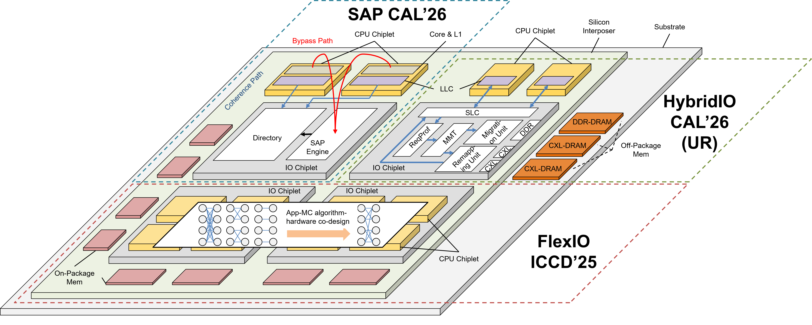
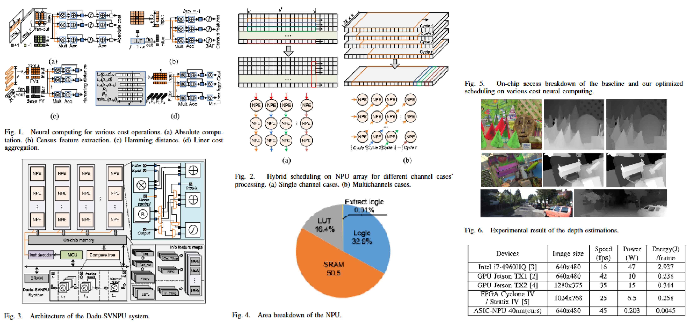
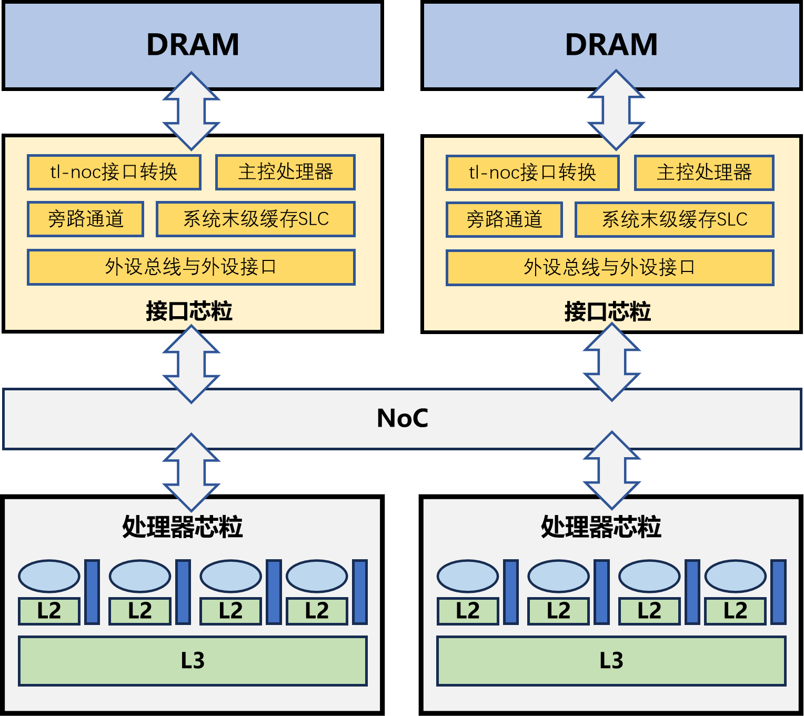
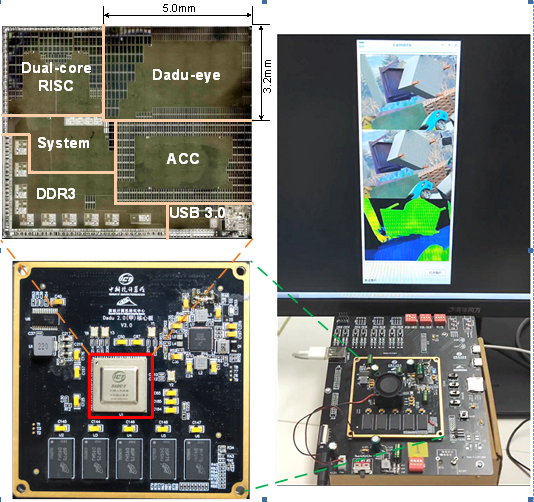

  <a href="{{ '/' | relative_url }}">English</a>
  &nbsp;|&nbsp;
  中文








正在施工中，请稍后...

# ℹ️ 自我介绍

黄俊培博士毕业于中国科学技术大学微电子学院，师从[韩银和教授](https://scholar.google.com/citations?user=t40cM-4AAAAJ&hl=zh-CN&oi=sra)，并与[王颖教授](https://scholar.google.com/citations?user=5LoFPSQAAAAJ&hl=zh-CN&oi=ao)、[许浩博副研究员](https://ieeexplore.ieee.org/author/37087137171)和[甘一鸣副研究员](https://scholar.google.com/citations?user=d-1MZhIAAAAJ&hl=zh-CN&oi=ao)保持密切的科研合作。博士期间，他作为联合培养博士生，在中国科学院计算技术研究所处理器全国重点实验室智能计算机研究中心（CICS@ICT, CAS）开展科研工作。**在芯片设计方面**，2020年至2022年，我参与了中国科学院战略性先导科技专项（C类）支持的“大度”（Dadu-Eye）深度学习边缘处理器的建模与测试工作；2022年至2025年，深度参与了国家重点研发计划支持的“大芯片”（Big Chip）多芯粒处理器的设计与验证工作；自2025年起，参与了中科院某项目支持的8核 RISC-V 某领域计算芯片的前端集成工作。**在科研项目方面**，博士期间，我积极协助导师申报多项科研项目（如国家重点研发计划项目），包括项目预申报书、正式申报书及答辩汇报材料的撰写与完善；同时参与组织和支持芯片第三方现场测试工作，并负责阶段性报告材料的编写。**在学术研究方面**，我的研究兴趣主要包括多芯粒存储系统体系结构设计，重点关注芯粒系统中的缓存一致性、I/O 芯粒体系结构、可扩展多芯粒存储子系统以及领域专用加速器设计。目前，我已在芯粒系统和人工智能加速器相关领域发表9篇学术论文<a href="https://scholar.google.com/citations?user=R6GxAr0AAAAJ&hl=zh-CN" target="_blank" rel="noopener" style="text-decoration:none;">
  📚
</a>，另有4篇论文正在审稿中，并拥有1项发明专利申请。

# 📖 教育背景
- 2016.09 - 2020.07, **电子科技大学（UESTC）**，中国四川成都
  - 电子科学与技术专业，工学学士，GPA：3.93/4.0，专业排名：前10%，获得推免资格
- 2018.09 - 2020.07, **伯明翰大学（UoB）**，英国伯明翰
  - 电子与电气工程专业，工学学士（2+2 联合培养双学位项目），GPA：4.25/4.25，学位等级：一等荣誉学位（First Class）
- 2020.09 - 2026.10, **中国科学技术大学（USTC）**，中国安徽合肥
  - 电子科学与技术专业，工学博士，硕博连读，GPA：3.88/4.3
  - 

# 🔥 科研新闻
- *2026.08*: &nbsp;🎉🎉 论文《A Scalable I/O-Chiplet Architecture with Learning-Guided Monte Carlo Tree Search for Memory Controller Mapping》（FlexIO@ICCD 的扩展版本）收到 IEEE TCAD 的大修（Major Revision）决定。
- *2026.07*: &nbsp;🎉🎉 论文《HybridIO: Enabling Bandwidth-Aware Memory Access Offloading for Multi-Chiplet Systems with CXL-Based Hybrid Memory》被 MEJ 2026 接收。
- *2026.02*: &nbsp;🎉🎉 论文《SAP: Shared-Aware Prefetching for Reducing Inter-Chiplet Data Access Latency》被 CAL 2026 接收。
- *2025.11*: &nbsp;🎉🎉 赴美国得克萨斯州达拉斯参加 ICCD 2025 国际会议，并对论文 FlexIO 进行口头报告（Oral Presentation）。
- *2025.08*: &nbsp;🎉🎉 论文《FlexIO: A Scalable IO Chiplet Architecture with Flexible Memory Controller Mapping》被 ICCD 2025 接收。

# 📝 近期论文发表情况、在投/审论文与专利

<section class="publication-section">
<h2>📋 Selected Publications</h2>
<article class="paper-card">
FlexIO: A Scalable IO Chiplet Architecture with Flexible Memory Controller Mapping

Junpei Huang, Haobo Xu, Ying Wang, et al.

ICCD 202543rd IEEE International Conference on Computer Design · pp. 674–681 · Oral Presentation, Dallas, USA
</article>
<article class="paper-card">
SAP: Shared-Aware Prefetching for Reducing Inter-Chiplet Data Access Latency

Junpei Huang, Haobo Xu, Yiming Gan, et al.

IEEE CAL 2026IEEE Computer Architecture Letters · Volume: 25, Issue: 1, Jan.-June 2026
</article>
<article class="paper-card">
HybridIO: Enabling Bandwidth-Aware Memory Access Offloading in Multi-Chiplet Systems with CXL-Based Hybrid Memory

Junpei Huang, Haobo Xu, Ying Li, et al.

MEJ 2026Microelectronics Journal · 107398
</article>
<article class="paper-card">
Application-Directed Hybrid Coherence for Wafer-Scale Supercomputing System

Meixuan Lu, Haobo Xu, Yiming Gan, Junpei Huang, et al.

IEEE CAL 2026IEEE Computer Architecture Letters · Volume: 25, Issue: 2, July-Dec. 2026
</article>
<article class="paper-card">
Space-Based Computing Chips: Current Status, Trends and Key Technique

Xiaotong Wei, Haobo Xu, Chundi Yin, Junpei Huang, et al.

JEIT 2025Journal of Electronics & Information Technology · 47(9): 2963–2978
</article>
<article class="paper-card">
The Big Chip: Challenge, Model and Architecture

Yinhe Han, Haobo Xu, Meixuan Lu, Haoran Wang, Junpei Huang, et al.

Fundamental Research 20244(6): 1431–1441
</article>
<article class="paper-card">
The Decomposition and Combination Paradigms of Chiplet-Based Integrated Chips

Fuping Li, Ying Wang, Meixuan Lu, Yutong Zhu, Haoran Wang, Zhun Zhao, Junpei Huang, et al.

ICS 2024Integrated Circuits and Systems · 1(1): 18–30
</article>
<article class="paper-card">
Dadu-SV: Accelerate Stereo Vision Processing on NPU

Feng Min, Ying Wang, Haobo Xu, Junpei Huang, et al.

IEEE ESL 2022IEEE Embedded Systems Letters · 14(4): 191–194
</article>
<article class="paper-card">
Toward Efficient Computing for Robotics: From a Circuit and System View

Haobo Xu, Yuxin Yang, Feng Min, Junpei Huang, et al.

IEEE TCAS-II 202269(7): 3051–3056
</article>
</section>
<section class="publication-section">
<h2>📋 Under Review / Revision</h2>
<article class="paper-card">
A Scalable I/O-Chiplet Architecture with Learning-Guided Monte Carlo Tree Search for Memory Controller Mapping

Junpei Huang, et al.

IEEE TCAD 2026Major Revision
</article>
<article class="paper-card">
REQ: Request Compression and Elastic Allocation for Memory Request Queues in AI Accelerators

Junpei Huang, Haobo Xu, Ying Li, et al.

ISCAS 2027Under Review
</article>
<article class="paper-card">
YUUMI: A Plug-and-Play Integration Architecture for RISC-V CPU-Vector Cores

Xiaotong Wei, Bowen Liu, Yiming Gan, Haobo Xu, Junpei Huang, et al.

ISCA 2027Under Review
</article>
<article class="paper-card">
IRV: A Tightly-Coupled Architecture for Out-of-Order RISC-V CPUs and Vector Cores

Xiaotong Wei, Yiming Gan, Haobo Xu, Junpei Huang, et al.

IEEE ESL 2026Major Revision
</article>
</section>
<section class="publication-section">
<h2>📋 Patents</h2>
<article class="paper-card">
  

    用于维护芯粒间缓存一致性的硅光网络
  

  

    胡义康、王梦迪、黄俊培、王颖、王郁杰、韩银和
  

  

    CN121455899A
    发明专利申请
    
      中国 · 2026年2月3日公开
    
  

</article>
</section>

# 🔬 研究主题

## 🧩 芯粒系统

  

  <!-- TODO: 写 chiplet 的文字说明 -->
我主要从事多芯粒存储体系结构研究，重点关注 I/O 芯粒、内存控制器映射以及可扩展的片间互连与缓存一致性机制。同时，我也对机器学习驱动的硬件优化与设计空间探索（Design Space Exploration, DSE）感兴趣。

<ul>
  <li><!-- TODO --> Key directions: heuristic-based memory controller mapping / learning-based memory controller mapping / DDR- and CXL- hybrid memory system and scheduling / inter-chiplet prefetching </li>
  <li><!-- TODO --> Methods: Gem5 + DRAMSim3 + DSNet</li>
</ul>

## 🧠 AI加速器

  

  <!-- TODO: 写 AI accelerator 的文字说明 -->
我致力于探索高效的人工智能加速器体系结构，包括数据流与存储层次结构的协同设计，以及面向新兴人工智能工作负载的系统级优化。

<ul>
  <li><!-- TODO --> Key directions: NPU/vision chips, throughput/W, dataflow</li>
  <li><!-- TODO --> Methods: architecture simulation + RTL prototyping</li>
</ul>

# 🎖 荣誉奖项
- 2021-2024年，中国科学技术大学研究生学业奖学金
- 2020年，电子科技大学优秀毕业生
- 2018-2020年，伯明翰大学国际本科生奖学金
- 2017年，电子科技大学优秀个人
- 2016-2017年、2017-2018年，电子科技大学优秀学生奖学金

# 💬 口头汇报
- 2025.11，在 ICCD 2025 国际会议上对录用论文《FlexIO: A Scalable IO Chiplet Architecture with Flexible Memory Controller Mapping》进行口头报告（Oral Presentation）。

# 💻 芯片流片项目

CPU chiplet and IO chiplet

Zhejiang Big Chip
- 支持最多 512 个处理器核心和 128 个芯粒，芯粒间缓存一致性通信延迟低于 100 ns。
- 个人贡献：体系结构设计空间探索、高层级缓存设计、RTL 实现与功能验证。

Dadu-Eye

Dadu-Eye Stereo Vision Chip
- 实现高效的深度感知，峰值能效达到 1 TOPS/W。
- 个人贡献：算法设计与建模、芯片测试。

# 🛠️ 技能
- Programming Skill: Python, C/C++, Shell, Verilog, Chisel
- Tools/Simulators: Vivado, Gem5, Ramulator, MATLAB
- Language: Mandarin, Cantonese (my hometown is Guangdong), English

# 💼 实习经历
- 2021 - 2026年，中国科学院计算技术研究所处理器全国重点实验室智能计算机研究中心，科研助理
- 2024 - 2026年，北京市开源芯片研究院（BOSC），SoC 设计工程师
# 🌍 访问地图

